# MixMonster

MixMonster is a small web tool for designing creative teaching and learning
settings. Teachers build a *collection*: a set of categories, each with a
list of criteria.
When the collection is used, the tool draws one criterion per category at
random and combines them into a "MixMonster", an unexpected scenario that a
group then works with.

The tool was built in 2021–2022 as a prototype in the HybridLR project at
TH Köln. The user interface is in German.

  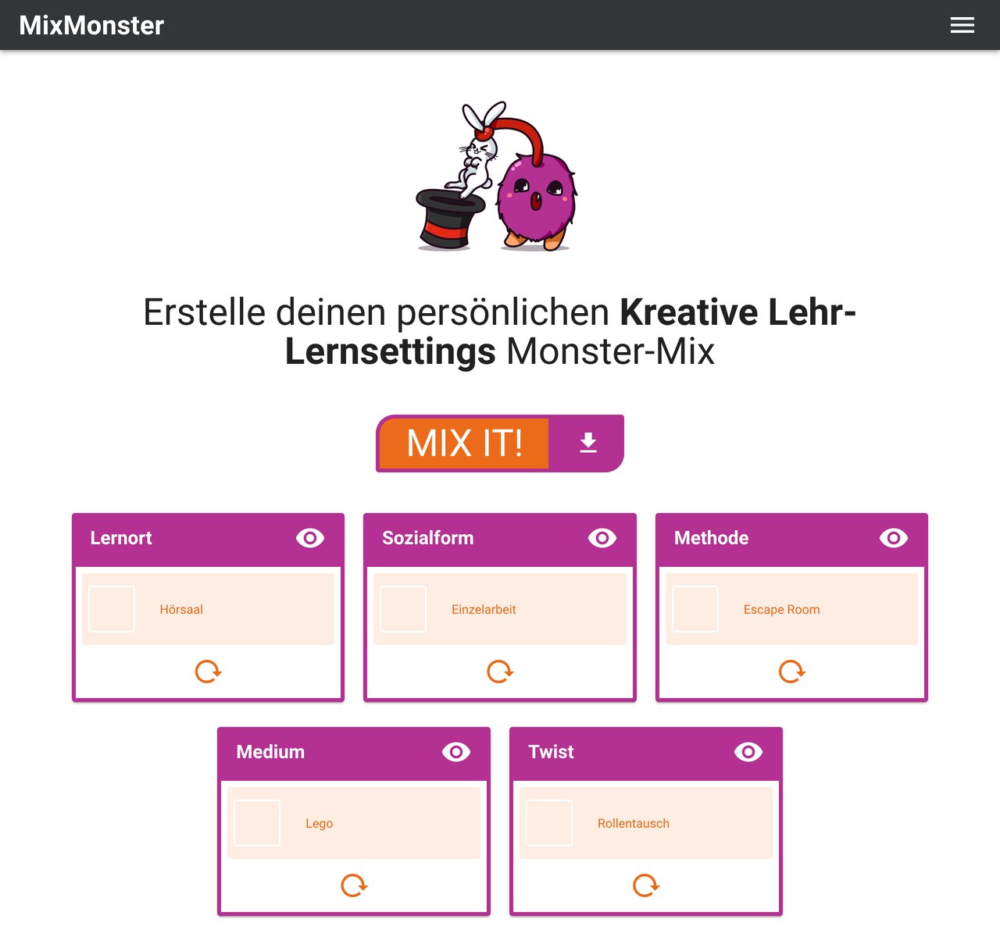

## Features

- Create, edit, preview and delete collections with categories and criteria
  (text and/or image per criterion, reorderable)
- Use a collection by reference number or link: random draw per category,
  optionally several criteria per category, re-roll single categories, and let
  participants narrow down a category's criteria before drawing
- Share a collection by link, reference number or QR code
- Export a collection as an Excel file and a drawn result as an image
- Login via Keycloak (OpenID Connect) for managing collections; using a
  shared collection needs no account

## Screenshots

The screenshots show the app with demo data.

| Start page | Your collections | Share by link or QR code |
|:-:|:-:|:-:|
| 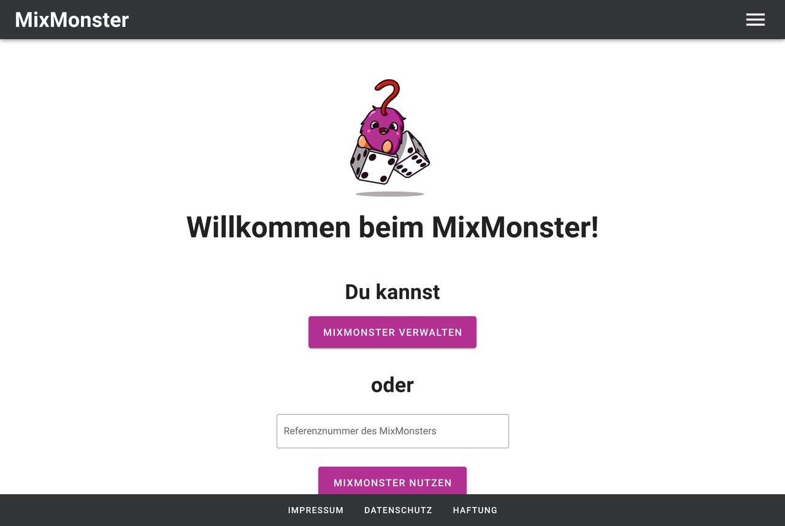 | 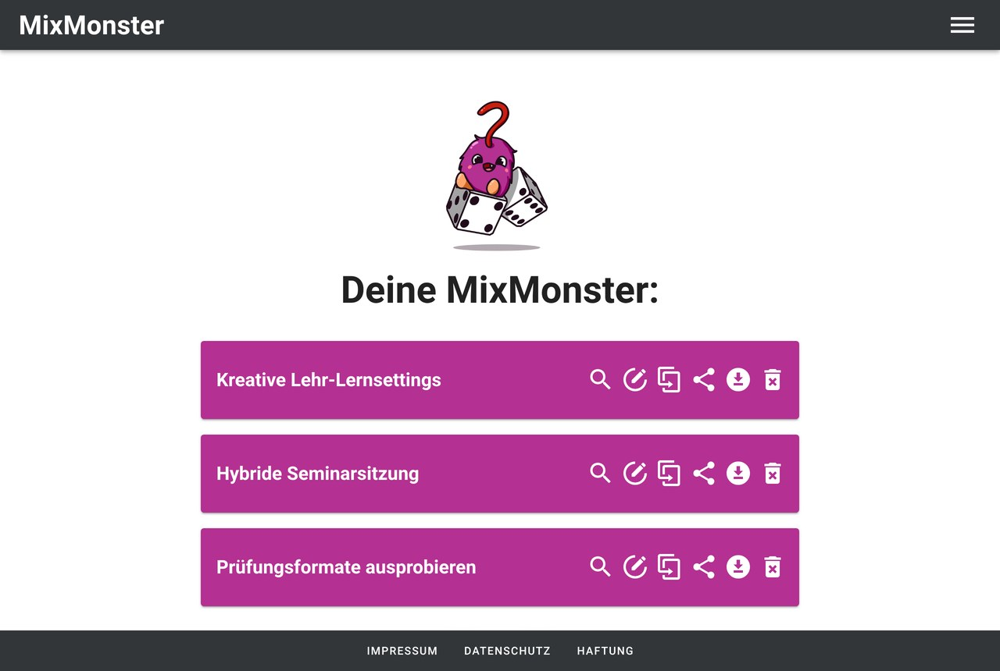 | 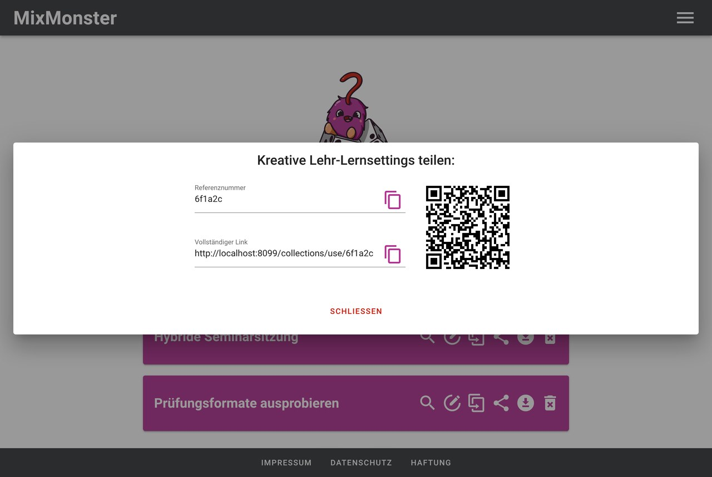 |

| Editing a collection | On a phone |
|:-:|:-:|
| 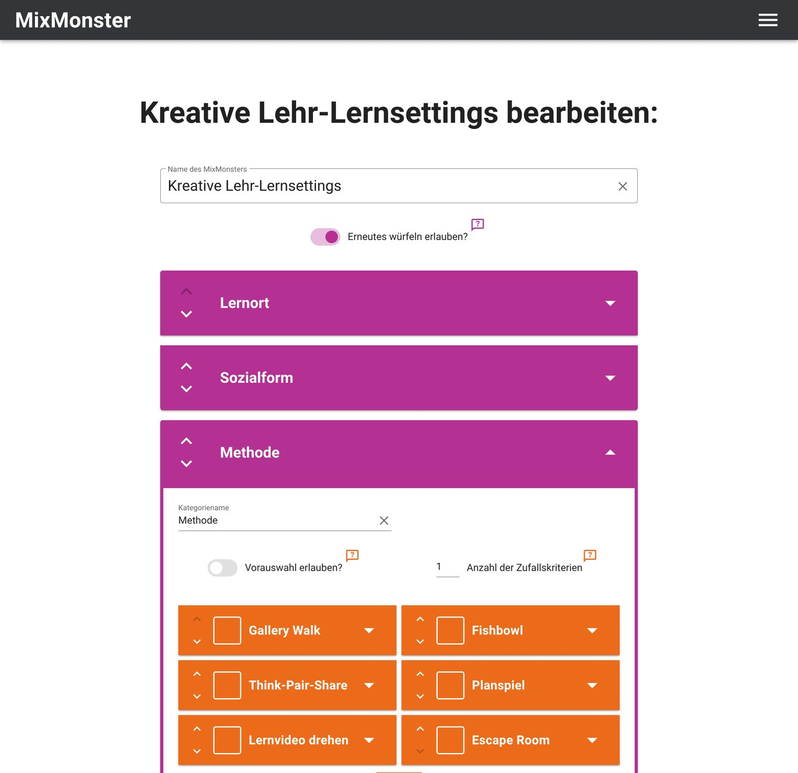 | 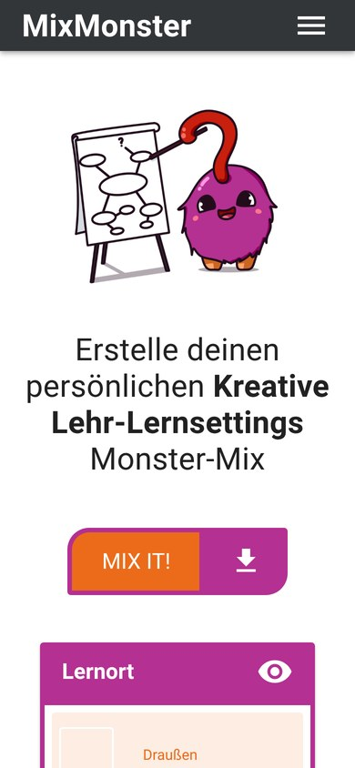 |

## The monsters

Each visit shows one of six MixMonster illustrations, picked at random. The
question-mark monster is the placeholder shown before the first draw.

| | | |
|:-:|:-:|:-:|
|  | 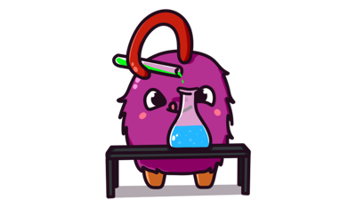 | 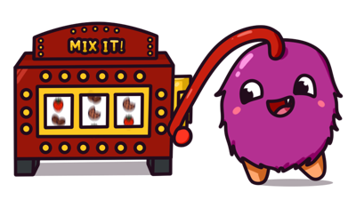 |
| Rolling the dice | In the lab | At the slot machine |
| 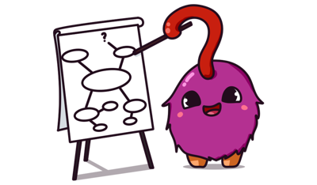 | 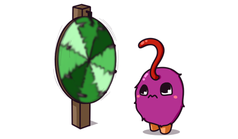 | 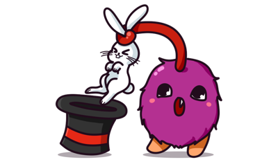 |
| At the flipchart | Wheel of fortune | Magic hat |

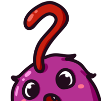

Illustrations by Sandy Linh Deimel, created for this project.

## Architecture

| Part | Stack |
|---|---|
| `mixmonster_frontend/` | Vue 2, TypeScript, Vuetify, Apollo Client, keycloak-js |
| `mixmonster_backend/` | Node.js, TypeScript, Fastify, GraphQL (graphql-helix, envelop auth), Mongoose |
| Database | MongoDB |
| Deployment | Docker Compose (frontend served by nginx) |

The GraphQL schema lives in `mixmonster_backend/src/schemas/schema.ts`;
TypeScript types are generated with GraphQL Code Generator (`npm run generate`).

## Running it locally

1. Copy `.env.example` to `.env` and fill in host, port and database values.
2. Copy `mixmonster_backend/keycloak.example.json` to `keycloak.json` and point
   it, and `mixmonster_frontend/public/keycloak.json`, to a Keycloak realm of
   your own. The original TH Köln realm is no longer active.
3. `docker compose up --build`

The frontend is then available on `MIXMONSTER_PORT`, the GraphQL API on port 4000.

## Status

Prototype, no longer maintained. Dependencies date from 2021 and have not
been updated.

## Credits

- Concept and development: Dennis Dubbert
- Illustrations (the monster images): Sandy Linh Deimel, created for this project

## Licence

Code: [MIT](LICENSE). The illustrations were created for MixMonster and are
not covered by the MIT licence; please ask before reusing them.
